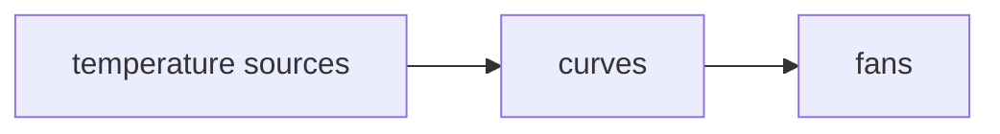

coolerd
=======

coolerd is a fan control daemon for Linux. It reads temperatures from sources, maps them through curves to a duty cycle, and sets fans to that duty cycle. One config file describes the sources, the curves and the fans of a machine.



coolerd runs on Linux only.

Origin
------

coolerd is a fork of [chenxiaolong/ipmi-fan-control](https://github.com/chenxiaolong/ipmi-fan-control), which Andrew Gunnerson wrote and has since archived. The Supermicro IPMI backend, which sets the fan duty cycle with Supermicro OEM raw commands through libfreeipmi, is that project's work. coolerd keeps its licence, the GNU GPL version 3 or later, and the `authors` field of `Cargo.toml` still names Andrew Gunnerson.

The upstream project was tested mainly on a 6028U-TR4T+, which uses the X10DRU-i+ motherboard. Its author reported that the fan control IPMI commands did not change across five generations of Supermicro motherboards. This is a record of what was tested. It does not promise that coolerd works on your board.

If you come from ipmi-fan-control, read [Migrating from ipmi-fan-control](docs/nixos.md#migrating-from-ipmi-fan-control). Existing config files still load.

What coolerd supports
---------------------

| Temperature source | Read through |
|---|---|
| `ipmi` | A temperature sensor of a board, over IPMI |
| `hwmon` | A hwmon chip under `/sys/class/hwmon`, found by its name |
| `file` | A file that holds millidegrees Celsius |
| `smart` | A drive, with `smartctl` |
| `hdparm` | A drive, with `hdparm -H` |
| `nvidia` | An NVIDIA GPU, with `nvidia-smi` |

| Fan | Driven through |
|---|---|
| `supermicro` | A fan zone of a Supermicro board, over IPMI |
| `hwmon` | A PWM channel of a hwmon chip |
| `nvidia` | A fan of an NVIDIA GPU, through the driver's NVML library |

Any source can drive any fan, with one exception: an `ipmi` source needs a `supermicro` fan in the same zone. Sources and zones can share a curve.

Installation
------------

coolerd has no prebuilt packages. This repository is a Nix flake, and its `packages.default` output builds the program:

```sh
nix build github:mniehe/ipmi-fan-control
sudo ./result/bin/coolerd --config config.toml
```

On NixOS, run coolerd as a service with the module of this flake. [NixOS](docs/nixos.md) shows how to add it to a host and describes every option.

On another system, build coolerd with `cargo build --release`. [Configuration](docs/configuration.md#building-from-source) lists what the build needs.

Quick start
-----------

1. Pick the example for your machine and copy it.

   | Machine | Config | NixOS recipe |
   |---|---|---|
   | Supermicro server | [`supermicro.toml`](docs/examples/supermicro.toml) | [`supermicro.nix`](docs/examples/supermicro.nix) |
   | Desktop or server without IPMI | [`hwmon-desktop.toml`](docs/examples/hwmon-desktop.toml) | [`hwmon-desktop.nix`](docs/examples/hwmon-desktop.nix) |
   | NVIDIA GPU fans | [`nvidia.toml`](docs/examples/nvidia.toml) | [`nvidia.nix`](docs/examples/nvidia.nix) |
   | Supermicro server with an NVIDIA GPU | [`mixed.toml`](docs/examples/mixed.toml) | [`mixed.nix`](docs/examples/mixed.nix) |

2. Change each value under a `REPLACE` comment: the sensor names, the chips, the drives and the curves of your machine. For a hwmon fan, first read [Finding hwmon chips and channels](docs/hwmon.md).
3. Read [Failures and shutdown](docs/failure.md), so that you know what the fans do when a sensor fails and when coolerd stops.
4. Start coolerd:

   ```sh
   sudo coolerd --config config.toml
   ```

When coolerd starts, it takes over the fans that the config names. A Supermicro board is switched to its full fan mode, and a hwmon channel is switched to manual control at full speed. When coolerd stops, it attempts to set these fans to full speed and to give back the control that it took. A process that is killed gives nothing back.

A wrong curve or a wrong fan can overheat hardware. Watch the temperatures after the first start. `log_level = "debug"` logs the temperatures and the duty cycle after each update.

Documentation
-------------

| Page | What it answers |
|---|---|
| [Configuration](docs/configuration.md) | Every config key, its default and its rule. How a zone turns temperatures into a duty cycle. |
| [Failures and shutdown](docs/failure.md) | What happens when a source cannot be read. What each fan gets when coolerd stops. What coolerd cannot cover. |
| [Finding hwmon chips and channels](docs/hwmon.md) | How to find the chip name and the PWM channel of a fan. |
| [NixOS](docs/nixos.md) | The NixOS module, its options, the recipes, and the move from `services.ipmi-fan-control`. |
| [`config.sample.toml`](config.sample.toml) | Every key in one commented file. |

Licence
-------

coolerd is free software under the GNU General Public License, version 3 or later. See [`LICENSE`](LICENSE).
