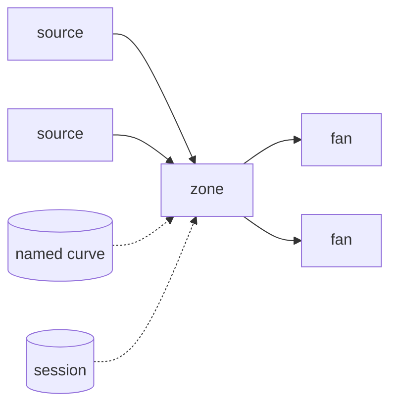
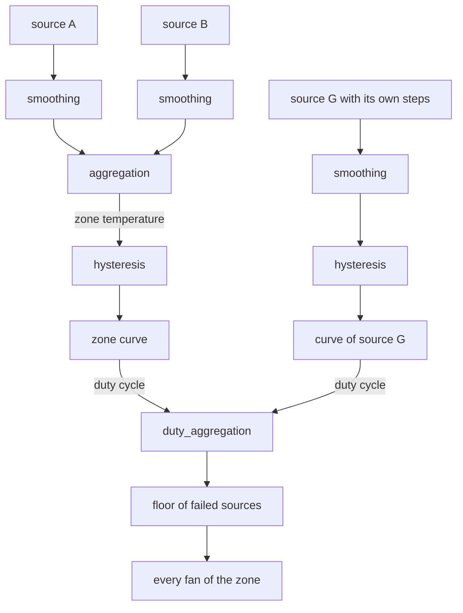

# Configuration

coolerd reads one TOML file. This page describes every key of that file, the rule that each key must meet, and how a zone turns temperatures into a duty cycle.

- [Running coolerd](#running-coolerd)
- [Building from source](#building-from-source)
- [The shape of a config](#the-shape-of-a-config)
- [Top-level keys](#top-level-keys)
- [Zone keys](#zone-keys)
- [How a zone sets its duty cycle](#how-a-zone-sets-its-duty-cycle)
- [Steps](#steps)
- [Named curves](#named-curves)
- [Sources](#sources)
- [Fans](#fans)
- [Sessions](#sessions)
- [Changes from earlier versions](#changes-from-earlier-versions)

To start from a working file, copy one of the [examples](examples/). [`config.sample.toml`](../config.sample.toml) shows every key in one file. [Failures and shutdown](failure.md) describes what coolerd does when a source fails and what the fans get when coolerd stops.

## Running coolerd

```sh
coolerd --config /etc/coolerd.toml
```

`--config`, or `-c`, is required. `--help` prints the usage and starts nothing. coolerd checks the whole file before it touches a fan. When a key breaks a rule, coolerd prints the path of the file and the key, such as `zones[0].steps[1].dcycle: values are not increasing`, and exits with status 1. A key that coolerd does not know is an error, so a misspelt key does not fall back to a default without a message. Two tables are not checked in this way yet: an `aggregation` or `duty_aggregation` of type `maximum`, and a session of type `local`, ignore keys that they do not know.

coolerd needs the rights to reach its devices: the IPMI device for a Supermicro fan, write access to the `pwmN` and `pwmN_enable` files for a hwmon fan, and root for an NVIDIA fan. The [NixOS module](nixos.md) sets these up.

coolerd writes its log to the standard error stream. Two environment variables change the log:

| Variable | Effect |
|---|---|
| `RUST_LOG` | Replaces `log_level`. It takes a filter such as `coolerd=debug`, and it can also turn on the logs of libraries. |
| `COOLERD_LOG_TIMESTAMPS` | `false`, `f`, `no`, `n` or `0` removes the timestamp from each log line. Use it when the log goes to a journal that adds its own. |

## Building from source

The [NixOS module](nixos.md) and `nix build .#default` build coolerd with everything it needs. To build it with `cargo build --release` on another system, install:

- the Rust compiler and `cargo`
- the freeipmi libraries, libfreeipmi and libipmimonitoring, with their headers
- `pkg-config`
- Clang, which generates the Rust bindings to the freeipmi libraries

coolerd needs the freeipmi libraries to build and to start, also on a host that has no IPMI device.

```sh
# Fedora
sudo dnf install freeipmi-devel pkgconf-pkg-config clang-devel cargo
# openSUSE
sudo zypper in freeipmi-devel pkgconf-pkg-config clang-devel cargo
# Arch Linux
sudo pacman -S freeipmi pkgconf clang cargo
# Debian and Ubuntu
sudo apt install libfreeipmi-dev libipmimonitoring-dev pkg-config libclang-dev cargo
```

Some sources and fans need a program or a library at run time. coolerd finds each program through `PATH`.

| Needed by | Program or library |
|---|---|
| [`smart` source](#smart-source) | `smartctl` from smartmontools, version 7.0 or later |
| [`hdparm` source](#hdparm-source) | `hdparm` |
| [`nvidia` source](#nvidia-source) | `nvidia-smi` from the installed NVIDIA driver |
| [`nvidia` fan](#nvidia-fan) | `libnvidia-ml.so.1` from the installed NVIDIA driver, loaded at run time |

## The shape of a config

A config has one or more zones. A zone reads its sources, maps the temperatures through curves to one duty cycle, and sets all its fans to that duty cycle.



Write zones, sources and fans as tables, as this page shows. A list of values in the order of the keys also loads, for old configs, but do not use it in a new config.

This is a complete config for a machine with two hwmon chips. One chip measures the CPU, and the other drives the fan:

```toml
[[zones]]
fans = [{ type = "hwmon", chip = "nct6798", pwm = 2 }]
sources = [{ type = "hwmon", chip = "k10temp", input = 1 }]
steps = [{ temp = 40, dcycle = 30 }, { temp = 80, dcycle = 100 }]
```

## Top-level keys

| Key | Type | Default | Rule |
|---|---|---|---|
| `log_level` | string | `"info"` | One of `error`, `warn`, `info`, `debug` and `trace`. |
| `zones` | list of tables | none, required | Must hold one zone or more. See [Zone keys](#zone-keys). |
| `curves` | table of tables | empty | See [Named curves](#named-curves). |
| `sessions` | table | the session `default`, a local one | See [Sessions](#sessions). |

The log levels, from the least output to the most:

- `error`: errors that stop coolerd, a source that starts to fail, and a fan that coolerd could not release.
- `warn`: also an IPMI sensor entry that the board could not read, and a program that coolerd killed and that did not exit.
- `info`: also the fan mode changes at start and stop, the start of each zone, and a source that reads again.
- `debug`: also one line for each fan after each update that succeeds, with the temperatures and the duty cycle. Use it to tune a curve.
- `trace`: also the parsed config, each failed attempt that is followed by a retry, and the raw IPMI commands.

## Zone keys

Each `[[zones]]` table is one zone.

| Key | Type | Default | Rule |
|---|---|---|---|
| `fans` | list of [fans](#fans) | none | The zone needs `fans` or `ipmi_zones`, not both. The list must not be empty and must not hold one fan twice. No other zone may drive the same fan. |
| `ipmi_zones` | list of integers 0 to 255 | none | The older form of `fans`. See [Supermicro fan](#supermicro-fan). |
| `sources` | list of [sources](#sources) | none, required | Must hold one source or more. |
| `steps` | list of [steps](#steps) | none | The zone curve. Required when a source has neither `steps` nor `curve`. Cannot stand beside `curve`. |
| `curve` | string | none | The name of a [named curve](#named-curves) to use as the zone curve. |
| `aggregation` | table | `{ type = "maximum" }` | How source temperatures become the zone temperature. `{ type = "average" }` or `{ type = "average", top = N }`, where `top` is greater than 0. |
| `duty_aggregation` | table | `{ type = "maximum" }` | How the duty cycles of the zone's curves become one. Same values as `aggregation`. |
| `hysteresis` | integer 0 to 255 | 0 | Degrees Celsius that the temperature of an inline curve must fall before the duty cycle follows. |
| `interval` | integer 1 to 65535 | 1 | Seconds that the zone waits after each update. The reads and the retries of an update add to the time between two updates. |
| `retries` | integer, 0 or more | 2 | Waits for another attempt that the sources of the zone share in one update. See [Failures and shutdown](failure.md#retries). |
| `retry_delay_ms` | integer, 0 or more | 500 | Milliseconds of each such wait. |
| `session` | string | `"default"` | The [session](#sessions) that reaches the board of the zone's Supermicro fans. The name must be a key of `sessions` or `default`. |

## How a zone sets its duty cycle

Each source is bound to one curve. A source without `steps` and without `curve` is bound to the zone curve, together with every other such source. A source with its own `steps`, or with `curve`, is bound to a curve of its own.



In each update the zone does these steps:

1. It reads each source. `smoothing_samples` on a source replaces the reading by the mean of the last readings of that source.
2. `aggregation` combines the sources that are bound to the zone curve into the zone temperature. `maximum` takes the highest temperature. `average` takes the mean, rounded down. `average` with `top = N` takes the mean of the N highest temperatures; when the zone has fewer than N temperatures, it uses them all and divides by their number.
3. `hysteresis` holds the temperature of each curve through small falls.
4. Each curve maps its temperature to a duty cycle. See [Steps](#steps).
5. `duty_aggregation` combines the duty cycles of the curves. `maximum` takes the highest duty cycle. `average` takes the mean, rounded up, and counts each curve once, however many sources feed it. `top = N` limits the mean to the N highest duty cycles.
6. A failed source with `on_failure = { type = "dcycle" }` can raise the result. See [Failures and shutdown](failure.md).
7. The zone sets each of its fans to the result.

With `duty_aggregation = { type = "average" }` the result can be lower than the highest duty cycle. The source behind the most demanding curve may then run hotter than its curve intends.

When every source has its own curve, the zone has no temperature. The zone's `steps` and `aggregation` are then not used, and `steps` may be omitted. Both are still checked when given.

### Hysteresis

Each curve holds a temperature. A reading at or above the held temperature replaces it at once. A lower reading replaces it only when it is `hysteresis` degrees or more below the held temperature. So the fans speed up without delay, and they do not slow down and speed up again around one temperature. With a held temperature of 72 °C and `hysteresis = 3`, readings of 70 °C and then 71 °C both map as 72 °C. The default is 0, which follows every reading.

The zone's `hysteresis` applies to inline `steps`: the zone's and those of each source. A [named curve](#named-curves) has its own `hysteresis` and never uses the zone's.

### Smoothing

`smoothing_samples = N` on a source replaces each reading by the mean of the last N readings of that source, rounded down. A short spike then moves the fans less. The default is 1, which uses each reading as it is. 0 is rejected.

The mean comes first: the zone temperature, the source's own curve and `hysteresis` all see the smoothed reading. The count is in updates, so the mean covers about N times `interval` seconds. When a source fails, coolerd drops the stored readings of that source, and the source starts again from fresh readings.

With `smoothing_samples = 3` and steps from 40 °C at 40% to 80 °C at 100%, readings of 40, 70, 40 and 40 °C give 40%, 62%, 55% and 55%. The same readings without smoothing give 40%, 85%, 40% and 40%.

Smoothing delays the response to real heat. `hysteresis` does not, because a reading above the held temperature acts at once. The mean holds only the readings since coolerd started or since the source last failed, so the first reading after either acts at once. After that, the cooler readings still in the mean hold back a sustained rise, until the Nth hot reading pushes out the last of them. The duty cycle can reach its target sooner, because the mean can cross the top step first: with `smoothing_samples = 3` and the steps above, three readings of 70 °C and then one of 100 °C give a mean of 80 °C and 100% at the first hot reading.

Use smoothing for a sensor whose readings jump, as some AMD CPU and GPU sensors do. Do not use it for a device that heats quickly.

### Example: a zone with two curves

In this zone the CPU uses the zone curve and the GPU its own. At CPU 50 °C and GPU 70 °C, the curves give 54% and 60%, and the zone runs at 60% in the first update. In later updates, `hysteresis` can hold the temperature of a curve above its reading, so the duty cycle can be higher than the current readings alone give.

```toml
[[zones]]
fans = [{ type = "supermicro", zone = 0 }]
sources = [
  { type = "ipmi", sensor = "CPU Temp" },
  { type = "nvidia", gpu = "00000000:81:00.0", steps = [{ temp = 60, dcycle = 40 }, { temp = 90, dcycle = 100 }] },
]
steps = [{ temp = 45, dcycle = 45 }, { temp = 75, dcycle = 100 }]
duty_aggregation = { type = "maximum" }
hysteresis = 3
```

## Steps

`steps` is a list of points on a curve. Each step is a table with two keys:

| Key | Type | Rule |
|---|---|---|
| `temp` | integer 0 to 255 | Degrees Celsius. Each step must have a higher `temp` than the step before it. |
| `dcycle` | integer 0 to 100 | The duty cycle in percent. A step must not have a lower `dcycle` than the step before it. |

A curve maps a temperature in this way:

- Below the first step, it gives the `dcycle` of the first step.
- Above the last step, it gives the `dcycle` of the last step.
- Between two steps, it gives a value on the straight line between them, rounded down.
- A curve with one step gives a fixed duty cycle.
- A curve with no steps gives 100%.

A duty cycle is a request to the fan backend, not a measured speed. A fan may not stop at 0%, a fan can stall at a low value, and a backend can raise or cap the request, as [Failures and shutdown](failure.md#the-duty-cycle-that-a-fan-gets) describes. Check the real speeds and temperatures on the host.

Three rules cover an empty or absent list:

- The `steps` of a source must hold one step or more. Remove the key to bind the source to the zone curve.
- The zone needs `steps` or `curve` when a source has neither.
- The zone curve must hold one step or more when some sources have their own curve and others do not.

## Named curves

A curve can be defined once in the top-level `curves` table. Any number of sources and zones can then name it with `curve`, in place of their own `steps`.

| Key | Type | Default | Rule |
|---|---|---|---|
| `curves.<name>.steps` | list of [steps](#steps) | none, required | The rules of a zone's `steps` apply. A curve that nothing names is still checked. |
| `curves.<name>.hysteresis` | integer 0 to 255 | 0 | Used in place of the zone's `hysteresis` by each source and zone that names the curve. |
| `curve`, on a source or a zone | string | none | Must be a name in `curves`. Cannot stand beside `steps`. |

A source or zone that names a curve behaves as if it had the curve's `steps` inline. So a source cannot name a curve with no steps, and a source that names a curve does not feed the zone temperature. Each source that names a curve maps its own temperature and holds it on its own. Two GPUs on one curve do not share a held temperature.

In this example both GPUs use the curve `gpu`. With both at 60, 72, 70 and 68 °C in turn, the zone runs at 40%, 64%, 64% and 56%. The fall of 2 °C to 70 °C is held, and the fall of 4 °C to 68 °C is followed. The same `steps` inline on each GPU, with the zone's `hysteresis = 3`, give the same duty cycles.

```toml
[curves.gpu]
steps = [{ temp = 60, dcycle = 40 }, { temp = 90, dcycle = 100 }]
hysteresis = 3

[[zones]]
fans = [{ type = "supermicro", zone = 0 }]
sources = [
  { type = "nvidia", gpu = "00000000:81:00.0", curve = "gpu" },
  { type = "nvidia", gpu = "00000000:82:00.0", curve = "gpu" },
]
```

[`examples/mixed.toml`](examples/mixed.toml) shows two zones that name one curve.

## Sources

A source is one table in the `sources` list of a zone. `type` selects the kind of source. Every source reports whole degrees Celsius from 0 to 255.

These keys work on every source:

| Key | Type | Default | Rule |
|---|---|---|---|
| `type` | string | none, required | `ipmi`, `file`, `hwmon`, `smart`, `hdparm` or `nvidia`. |
| `steps` | list of [steps](#steps) | none | A curve for this source alone. Must hold one step or more. Cannot stand beside `curve`. |
| `curve` | string | none | The name of a [named curve](#named-curves) for this source. |
| `smoothing_samples` | integer 1 to 255 | 1 | See [Smoothing](#smoothing). |
| `on_failure` | table | `{ type = "exit" }` | What the zone does when the source cannot be read: `{ type = "exit" }`, `{ type = "ignore" }` or `{ type = "dcycle", dcycle = N }` with N from 0 to 100. See [Failures and shutdown](failure.md#on_failure). |

[Failures and shutdown](failure.md#what-counts-as-a-failure) lists what makes a read of each source fail.

### `ipmi` source

```
{ type = "ipmi", sensor = "CPU Temp" }
```

| Key | Type | Rule |
|---|---|---|
| `sensor` | string | The name of a temperature sensor of the board. The sensor must report degrees Celsius. |

The zone must have a `supermicro` fan, because coolerd opens an IPMI session only for such a zone. The source reads the sensor through the zone's `session`. A value with a fraction is rounded down. To list the sensor names of the local board, run `ipmi-sensors --sensor-types=Temperature`, a freeipmi program.

### `file` source

```
{ type = "file", path = "/sys/class/thermal/thermal_zone1/temp" }
```

| Key | Type | Rule |
|---|---|---|
| `path` | string | A file that holds one whole number in millidegrees Celsius, in ASCII, with nothing but whitespace around it. |

The source divides the number by 1000 and rounds down. The path must be a regular file after symbolic links are followed, as sysfs files are. The `thermal_zone` files of Linux meet these rules.

### `hwmon` source

```
{ type = "hwmon", chip = "k10temp", input = 1 }
```

| Key | Type | Rule |
|---|---|---|
| `chip` | string | The text of the chip's `name` file. Must not be empty and must not start or end with whitespace. |
| `input` | integer 1 to 255 | The number N of the chip's `tempN_input` file. |

The source reads `tempN_input`, in millidegrees Celsius, and rounds up to whole degrees. A reading above 255 °C counts as 255 °C. The source finds the chip by its name on every read, never by its `hwmonN` number, because that number can change between boots. [Finding hwmon chips and channels](hwmon.md) shows how to list the names and inputs.

Use a `hwmon` source in place of a `file` source for a file under `/sys/class/hwmon`, because the path of such a file can change between boots.

### `smart` source

```
{ type = "smart", block_dev = "/dev/disk/by-id/ata-ST6000VN001-2BB186_ZR12WE0S" }
```

| Key | Type | Rule |
|---|---|---|
| `block_dev` | string | The block device of the drive. Use a name under `/dev/disk/by-id`, which does not change between boots. |

The source runs `smartctl -j -A -n standby <block_dev>` and reads the current temperature from the output. It needs smartmontools 7.0 or later. A drive that is spun down may report no temperature, which fails the read. coolerd needs the rights to query the drive: root, or the capabilities that the [NixOS module](nixos.md) grants.

### `hdparm` source

```
{ type = "hdparm", block_dev = "/dev/disk/by-id/ata-HGST_HUH721212ALE600_XXXXXXXX" }
```

| Key | Type | Rule |
|---|---|---|
| `block_dev` | string | The block device of the drive. |

The source runs `hdparm -H <block_dev>`. Some Hitachi, HGST and Western Digital drives answer it, also while they are spun down. The source reads temperatures from 0 to 127 °C.

### `nvidia` source

```
{ type = "nvidia", gpu = "00000000:01:00.0" }
```

| Key | Type | Rule |
|---|---|---|
| `gpu` | string | The PCI bus id of the GPU, such as `00000000:01:00.0` or `0000:01:00.0`, or its UUID, such as `GPU-xxxxxxxx-xxxx-xxxx-xxxx-xxxxxxxxxxxx`. |

The source runs `nvidia-smi -i <gpu> --query-gpu=temperature.gpu --format=csv,noheader,nounits`. A GPU index such as `0` is rejected, because the order of the indexes can change between boots. To list the bus ids and UUIDs, run:

```sh
nvidia-smi --query-gpu=pci.bus_id,uuid --format=csv
```

`nvidia-smi` must come from the NVIDIA driver that the host runs. An `nvidia` source does not need an `nvidia` fan: it can drive any fan.

## Fans

A fan is one table in the `fans` list of a zone. `type` selects the backend. A zone sets every fan in its list to the zone's duty cycle. A fan belongs to one zone.

A backend does not always apply the duty cycle that the zone asks for. [Failures and shutdown](failure.md#the-duty-cycle-that-a-fan-gets) gives the rule of each backend. The same page describes what each fan gets when coolerd stops.

### Supermicro fan

```
{ type = "supermicro", zone = 0 }
```

| Key | Type | Rule |
|---|---|---|
| `zone` | integer 0 to 255 | The number of an IPMI fan zone of the board. |

A `supermicro` fan is one IPMI fan zone of the board that the zone's `session` reaches. A board groups its fan headers into zones; on most boards, zone 0 holds the headers `FAN1`, `FAN2` and so on, and zone 1 the headers `FANA`, `FANB` and so on. Check the manual of your board.

When coolerd starts, it saves the fan mode of each board that it uses. It then switches the board to the full fan mode, unless the board is in that mode already.

`ipmi_zones = [0, 1]` on a zone is the older form of `fans = [{ type = "supermicro", zone = 0 }, { type = "supermicro", zone = 1 }]`, and it still loads. A zone sets `fans` or `ipmi_zones`, not both. A number that `ipmi_zones` repeats is driven once.

Two zones on one session cannot name the same IPMI zone. The check compares session names, so it does not detect two session names that reach the same board. Do not drive one board through two sessions.

### hwmon fan

```
{ type = "hwmon", chip = "nct6798", pwm = 2 }
```

| Key | Type | Rule |
|---|---|---|
| `chip` | string | The text of the chip's `name` file. Must not be empty and must not start or end with whitespace. |
| `pwm` | integer 1 to 255 | The number N of the chip's `pwmN` file. |

A `hwmon` fan is one PWM channel of a hwmon chip under `/sys/class/hwmon`. Two zones cannot drive the same chip and channel. [Finding hwmon chips and channels](hwmon.md) shows how to find the name and the channel. Do not configure a channel before you know which fan it drives.

coolerd finds the chip by its name once, when the zone starts. A name that no chip has, or that more than one chip has, is an error, so coolerd cannot drive one of two chips with the same name. `pwmN` and `pwmN_enable` must be files in the chip's own hwmon directory. coolerd needs write access to both.

When the zone starts, coolerd saves `pwmN_enable`, writes 1 to it, which is manual control, and writes 255 to `pwmN`, which is full speed. A zone with only `hwmon` fans needs no IPMI device.

### NVIDIA fan

```
{ type = "nvidia", gpu = "00000000:01:00.0", fan = 0 }
```

| Key | Type | Rule |
|---|---|---|
| `gpu` | string | The PCI bus id of the GPU. The domain has four or eight hex digits, in either case, so `0000:01:00.0` and `00000000:01:00.0` name the same GPU. A UUID is rejected. |
| `fan` | integer, 0 or more | The number of the fan on that GPU. The first fan is 0. |

An `nvidia` fan is one fan of an NVIDIA GPU. Two zones cannot drive the same fan of one GPU, in either spelling of the bus id. To list the bus ids, run `nvidia-smi --query-gpu=pci.bus_id --format=csv`.

The NVIDIA fan backend is tested against a stand-in for NVML. It has not yet been confirmed on a GPU, so check the fans after the first start, as [Checking NVIDIA fans on a host](nixos.md#checking-nvidia-fans-on-a-host) describes.

coolerd drives the fan through NVML, the management library of the NVIDIA driver. It loads `libnvidia-ml.so.1` at run time, when a zone with an `nvidia` fan starts, because the library must match the driver that the kernel has loaded. A config without an `nvidia` fan never loads it. The dynamic linker must be able to find the library. coolerd must run as root to set a GPU fan speed.

When the zone starts, coolerd reads the number of fans of the GPU and the speed limits of the fan, and logs the limits in a line with `speed limits`. It fails when the fan does not exist or when the limits are not a range within 0 to 100%. It changes nothing at this point. The first update sets the fan speed, which switches the fan to manual control.

## Sessions

A session is a connection to the BMC of one board. coolerd uses it to read `ipmi` sources and to drive `supermicro` fans. A config needs a `sessions` table only to reach a board in another machine.

The session `default` always exists. Unless the config defines it, it is a local session, which uses the IPMI device of this machine, such as `/dev/ipmi0`. A zone without `session` uses `default`.

```toml
[[zones]]
session = "bmc"
fans = [{ type = "supermicro", zone = 0 }]
sources = [{ type = "ipmi", sensor = "CPU Temp" }]
steps = [{ temp = 40, dcycle = 30 }, { temp = 75, dcycle = 100 }]

[sessions]
bmc = { type = "remote", hostname = "bmc.example.com", username = "admin", password = "secret" }
```

| Key | Type | Rule |
|---|---|---|
| `sessions.<name>.type` | string | `local` or `remote`. |
| `sessions.<name>.hostname` | string | Required for `remote`. Must not contain a NUL byte. |
| `sessions.<name>.username` | string | Required for `remote`. Must not contain a NUL byte. |
| `sessions.<name>.password` | string | Required for `remote`. Must not contain a NUL byte. |

The password is plain text in the config file. Make the file readable only by the user that coolerd runs as.

coolerd opens a session only when a zone on it has a `supermicro` fan. A session that no such zone uses is checked but never opened.

A session can also be a list of `ipmitool` arguments, such as `["-I", "lanplus", "-H", "bmc.example.com", "-U", "admin", "-P", "secret"]`. This form exists for old configs. Use the table form in a new config.

## Changes from earlier versions

The format of the config file is the format of ipmi-fan-control. A config written for it loads in coolerd, unless two of its zones drive the same IPMI zone, as the second point says. These points behave in another way than they did in earlier versions:

- **`average` with `top`.** An `average` `aggregation` divides by the number of temperatures it used; `top` only caps that number. Earlier versions divided by `top` even when the zone had fewer sources. A zone whose `top` is higher than its number of sources now gets a higher zone temperature, and its fans can run faster: readings of 80 °C and 80 °C with `top = 3` give 80 °C, where they gave 53 °C.
- **One fan, one zone.** Two zones on one session can no longer name the same IPMI zone. Earlier versions loaded such a config, and the zones overwrote each other's duty cycle.
- **Retries.** Only a source that fails is read again. Earlier versions read every source of the zone again when one source failed.
- **Time limits.** `smartctl` and `hdparm` are stopped after 30 seconds. Earlier versions waited for them without a limit.
- **Exit status.** When coolerd fails to release a fan as it stops, it exits with status 1, also when a signal stopped it. Earlier versions exited with status 0.
- **Signals.** coolerd listens for SIGINT and SIGTERM before it opens an IPMI session. Earlier versions started to listen only after the zones had started.

[Migrating from ipmi-fan-control](nixos.md#migrating-from-ipmi-fan-control) lists the names that the rename changed.
