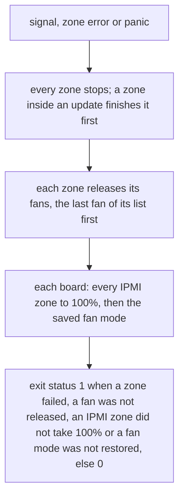

# Failures and shutdown

This page describes what coolerd does when a temperature source cannot be read, what each fan gets when coolerd stops, and the cases that coolerd cannot cover. Read it before you rely on coolerd to cool a machine.

- [When a source fails](#when-a-source-fails)
- [What the fans get when coolerd stops](#what-the-fans-get-when-coolerd-stops)
- [The duty cycle that a fan gets](#the-duty-cycle-that-a-fan-gets)
- [Exit status](#exit-status)
- [Limits](#limits)

## When a source fails

In each update a zone reads each of its sources, with the retries that are described below. It reads the sources that are not `ipmi` first, in the order of `sources`. It then reads all `ipmi` sources in one IPMI query, so that the sensor readings are fresh when the zone sets its duty cycle. Each sensor in that query can fail on its own.

### What counts as a failure

| Source | The read fails when |
|---|---|
| `ipmi` | The query fails. The board has no temperature sensor with the name. The sensor has no reading. The sensor reports a unit other than degrees Celsius. The value is below 0, or is 256 or more. |
| `file` | The path is not a regular file after symbolic links are followed, such as a FIFO, a directory or a device; coolerd does not read it. The file cannot be read. The content is not one whole number, or is negative. The number is 256000 or more. |
| `hwmon` | No chip or more than one chip has the name. A `name` file exists but cannot be read. `tempN_input` is missing, cannot be read or does not hold a whole number. A file of the chip holds more than 64 bytes. The reading is below 0 °C. The chip has a `tempN_fault` file, and it holds a value other than 0 or cannot be read or parsed. |
| `smart` | `smartctl` exits with a status other than 0 or 2, or does not exit within 30 seconds. The output is not JSON, has no current temperature, or has one that is not a whole number from 0 to 255. |
| `hdparm` | `hdparm` exits with a status other than 0, or does not exit within 30 seconds. The output has no drive temperature line, reports bad or missing sense data, or has a temperature that is not a whole number from 0 to 127. |
| `nvidia` | `nvidia-smi` exits with a status other than 0, or does not exit within 5 seconds. The output is not one whole number from 0 to 255; `[N/A]` fails. |

A `hwmon` chip reports a negative value for a probe that is not connected. A real temperature below 0 °C fails the source as well.

When a board reports two sensors with one name, an `ipmi` source with that name fails if either of them cannot be read or has no reading.

coolerd also limits the standard output that it reads from a program: 1 MiB from `smartctl` and `hdparm`, and 4096 bytes from `nvidia-smi`. Longer output fails the read.

### Programs that do not answer

A program must exit and close its standard output within its time limit. Otherwise coolerd kills it and waits up to half a second for it to go. coolerd kills only that program, not the processes that the program started. A wrapper script used in place of one of these tools must not leave helper processes behind.

A killed program can fail to exit, as `nvidia-smi` can in a hung driver. Its source then does not start the program again until the old process is gone, and until then that source fails at once. Each source tracks only its own process. Other sources still run, including sources that run the same program.

### Retries

A source that fails is read again after `retry_delay_ms`. A source that read well is not read again. All sources of a zone share `retries` waits in each update, so a source that uses them up leaves none for the sources that are read after it. With the default of 2, one failing source gets 3 attempts.

`retries` limits the number of waits in an update, not the duration of the update. Each attempt also takes as long as the source needs to answer.

A source that failed in the previous update gets one attempt in each update and no retries, until it reads again. A source that keeps failing therefore leaves the retries to the other sources and adds one attempt to each update.

The `ipmi` sources of a zone share each IPMI query. A repeated query serves every sensor that has not read yet. So a sensor that failed in the previous update, and has no retry of its own, still takes the value of a query that another sensor caused.

### `on_failure`

When a source still fails after its last attempt, its `on_failure` decides what the zone does:

- `{ type = "exit" }`, the default: coolerd stops with an error at once. The zone reads no further source in that update and sets no new duty cycle. On its way out it releases every fan of every zone, as [the next section](#what-the-fans-get-when-coolerd-stops) describes.
- `{ type = "ignore" }`: the zone leaves the source out. Its reading does not enter the zone temperature, and its own curve gives no duty cycle. The other sources keep driving the fans.
- `{ type = "dcycle", dcycle = N }`: the zone leaves the source out as with `ignore`, and runs at N% or more until the source reads again. The other curves can still raise the fans above N%.

When no source of a zone has a reading, and no failed source has `exit`, the zone runs at 100%, whatever the `dcycle` of its sources.

coolerd logs one error when a source starts to fail and one message when it reads again. A source that fails in every update is still tried once in every update. While every source of a curve fails, the curve keeps its held temperature, so `hysteresis` applies from there when a source reads again.

`ignore` has a risk: a hot device that cannot be read no longer raises the fans. Use `ignore` only for a source whose heat another source also measures, such as a second sensor on the same CPU. For a device that produces much heat, such as a GPU, use `dcycle` with a duty cycle that keeps the device cool under full load.

In this example the GPU falls back to 80%. With the CPU at 50 °C, a failed GPU runs the zone at 80%, where `ignore` would run it at 54%, the duty cycle of the CPU curve. With the CPU at 75 °C, the zone runs at 100% either way.

```toml
[[zones]]
fans = [{ type = "supermicro", zone = 0 }]
sources = [
  { type = "ipmi", sensor = "CPU Temp" },
  { type = "nvidia", gpu = "00000000:81:00.0", steps = [{ temp = 60, dcycle = 40 }, { temp = 90, dcycle = 100 }], on_failure = { type = "dcycle", dcycle = 80 } },
]
steps = [{ temp = 45, dcycle = 45 }, { temp = 75, dcycle = 100 }]
```

## What the fans get when coolerd stops

coolerd releases every fan when it stops. To release a fan is to leave it in a state that is safe without coolerd: full speed, or the control of the board, the chip or the driver. The release is an attempt. coolerd cannot make a broken device obey.

coolerd runs the release in each of these cases:

- SIGINT or SIGTERM stops it, as `systemctl stop` does.
- A zone returns an error: a source with `on_failure = { type = "exit" }` failed, or a fan refused a duty cycle.
- A zone panics, which is a bug in coolerd.
- The start fails part way. The fans and the boards that coolerd has taken over by then are released.

One zone that stops with an error stops every zone. coolerd logs each error that a zone returns as soon as it receives it, in a line that starts with `Zone error:`, also an error that a zone returns while it stops after a signal or after the error of another zone. The first of these errors sets the exit status, and coolerd logs it once more as it exits.



When the release of one fan fails, coolerd logs an error that names the fan, and the next fan still gets its attempt.

### Supermicro fan

coolerd sets the IPMI zone of the fan to 100%. After every zone has stopped, coolerd sets each IPMI zone that the config names on the board to 100%, for most zones a second time, and then restores the fan mode that it saved at the start.

When the saved mode was the full mode, coolerd restores nothing: the board stays in the full mode at 100%.

When the restore of the fan mode fails, coolerd logs an error that names the session and exits with status 1. The board may then stay in the full mode. When a write of 100% in this last step fails, coolerd logs an error that names the session and the IPMI zone, still makes the other writes and the restore, and exits with status 1. This write can be the only one of 100% that the zone gets: a signal that arrives before a zone has started stops it before it can release its fans.

When the switch to the full mode fails at the start, coolerd runs the same steps before it exits.

### hwmon fan

coolerd writes 255, full speed, to `pwmN`. Then, when the saved `pwmN_enable` is 2 or more, it writes that value back. It attempts both writes, also when the first fails.

Values from 2 up are modes that the driver defines. On most chips they are automatic modes, so the firmware or the driver takes the fan over again.

A saved value of 0 or 1 is not written back, and the channel stays under manual control at 255. A saved 1 means that the channel was already manual. A saved 0 means full speed on most chips, but it switches the fan off under the kernel's `pwm-fan` driver.

### NVIDIA fan

coolerd gives the fan back to the default fan policy of the driver. That policy is the GPU's own fan curve: the driver sets the speed from the GPU temperature again, and it may run the fan slower than the zone did.

When that call fails, coolerd sets the fan to its maximum under manual control. It logs a line that starts with `Failed to give fan` and ends with `set it to its maximum of <max>% under manual control`. The fan then stays in manual control at its maximum until something sets it again. A later run of coolerd sets it in its first update and gives it back to the driver when it stops normally. A reload of the driver also ends the manual control.

When the call that sets the maximum fails as well, the line ends with `the fan's state is unknown`. The fan may keep the last speed that coolerd set.

In both cases coolerd exits with status 1.

coolerd releases an NVIDIA fan only when the start of its zone got as far as reading the limits of the fan. Before that point coolerd has changed nothing on the fan, and it makes no call to release it.

## The duty cycle that a fan gets

A duty cycle is a request, not a measured speed. A backend does not always apply the duty cycle that the zone asks for, and a fan does not always turn at the speed that the backend sets. A fan may not stop at 0%, and a fan can stall at a low value.

| Fan | What the backend applies |
|---|---|
| `supermicro` | The duty cycle in percent, as it is. |
| `hwmon` | The duty cycle on the scale from 0 to 255, rounded up, so the value is never below the one that the zone asks for. 50% is 128. |
| `nvidia` | The duty cycle, raised to the fan's minimum and capped at its maximum. NVML refuses a speed below the minimum. With a minimum of 30%, a duty cycle of 20% runs the fan at 30%. |

coolerd reads the two limits of an `nvidia` fan from the driver when the zone starts, and logs them in a line with `speed limits`.

A `supermicro` fan and a `hwmon` fan are read before each update, and coolerd writes only when the value differs from the one it wants. An `nvidia` fan is written in the first update, and then whenever the speed after the limits differs from the last speed that coolerd sent. The debug log shows, for each fan after each update, the duty cycle that the fan reported before the update, the duty cycle of the zone and the value that coolerd sent. A `-` stands for a value that could not be read or for a write that was not needed. The values of a `hwmon` fan are shown in percent, rounded up.

A `supermicro` or `hwmon` fan that cannot be read, and any fan that refuses a write, stops coolerd with an error. coolerd then releases every fan.

## Exit status

| Status | Meaning |
|---|---|
| 0 | SIGINT or SIGTERM stopped coolerd, no zone returned an error, every fan was released, every IPMI zone took 100% and every board got its saved fan mode back. Also after `--help`. |
| 2 | The command line was wrong, such as a missing `--config`. |
| 1 | Any other error: a config error, a failed start, a source failure with `on_failure = { type = "exit" }`, a fan that refused a duty cycle, a panic, a fan that could not be released, an IPMI zone that could not be set to 100% as coolerd stopped, or a fan mode that could not be restored. A zone error counts also when a signal came first. |

The [NixOS module](nixos.md) restarts the service 10 seconds after an exit with status 1.

## Limits

coolerd cannot cover these cases. Plan for them.

- **A killed process releases nothing.** SIGKILL, a power loss and a crash of the machine end coolerd without the release. So does any signal other than SIGINT and SIGTERM that ends the process, such as SIGHUP. The fans keep the last state that coolerd set, for as long as the device keeps it: a board stays in the full mode at its last duty cycle, a hwmon channel stays manual at its last value, and an NVIDIA fan stays manual at its last speed.
- **After a kill, the saved state is lost.** The next start of coolerd finds the board in the full mode, or the hwmon channel in manual control, and saves that. When it stops, it leaves the board in the full mode at 100%, or the channel in manual control at 255. To get the earlier fan mode of a board back, set it through the BMC. A hwmon chip usually returns to its automatic mode at the next boot. An NVIDIA fan is different: every normal stop gives it back to the default policy.
- **A blocked update delays the release.** A zone that is inside an update finishes it before it releases its fans. The programs that a source runs and the NVML calls have time limits. coolerd sets no time limit of its own on an IPMI query, on a read of a `file` source, or on a read or write of a hwmon file, and none on the stop as a whole. A service manager that kills a slow stop, as systemd does after its stop timeout, ends coolerd without the release.
- **A hwmon fan keeps the device path that it found at the start.** If the driver of the chip is unbound and bound again while coolerd runs, another chip can take that path, and coolerd then drives that chip. Restart coolerd after you reload or rebind a hwmon driver.
- **An NVML call that hangs stops all NVML work.** Each NVML call has a time limit of 5 seconds. A call made before the library has loaded gets 30 seconds more for the load, 35 seconds in all. The time that a call waits behind other NVML calls counts toward its limit. A call that does not return in time fails, and so does its zone. NVML calls cannot be stopped, so coolerd then makes no further NVML call: the release of each NVIDIA fan that it had taken over fails at once and is logged, and coolerd exits with status 1. Restart coolerd after the driver recovers.
- **Two names for one device are not detected.** coolerd does not detect two session names that reach the same board. It refuses a hwmon chip name that two chips share.
- **`ignore` hides a hot device.** See [`on_failure`](#on_failure).
