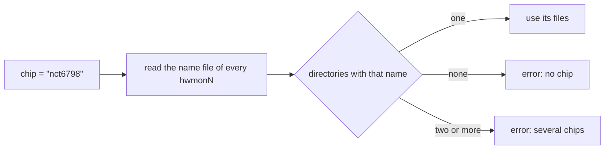

# Finding hwmon chips and channels

A `hwmon` source and a `hwmon` fan name a chip and a number. This page shows how to find both on your machine. Every command on this page only reads.

- [How coolerd finds a chip](#how-coolerd-finds-a-chip)
- [List the chips](#list-the-chips)
- [Find a temperature input](#find-a-temperature-input)
- [Find the PWM channels](#find-the-pwm-channels)
- [Find the fan behind a channel](#find-the-fan-behind-a-channel)
- [Write the config](#write-the-config)

## How coolerd finds a chip

The kernel shows each hardware monitoring chip as a directory `/sys/class/hwmon/hwmonN`. The number N can change between boots, so coolerd never uses it. coolerd reads the `name` file of each directory and takes the one directory whose name, without surrounding whitespace, equals `chip` in the config.



Two rules follow:

- When two chips have the same name, coolerd cannot tell them apart, and it refuses both. Two CPUs with `coretemp`, or two NVMe drives with `nvme`, are common cases.
- The files that coolerd uses must be in the hwmon directory itself: `tempN_input` and `tempN_fault` for a source, `pwmN` and `pwmN_enable` for a fan. coolerd does not look under `device/`.

A chip appears under `/sys/class/hwmon` only when its kernel module is loaded. If a chip of your board is missing, find its module, as `sensors-detect` from lm_sensors can, and load it. On NixOS, [`hwmon.kernelModules`](nixos.md#servicescoolerdhwmonkernelmodules) loads it at boot.

## List the chips

```sh
grep -H . /sys/class/hwmon/hwmon*/name
```

Each line of the output is a directory and its name:

```
/sys/class/hwmon/hwmon2/name:k10temp
/sys/class/hwmon/hwmon3/name:nct6798
```

The text after the last colon is the value for `chip`. The commands below use `hwmon2` and `hwmon3` from this output. Put in the directories of your chips.

## Find a temperature input

```sh
grep -H . /sys/class/hwmon/hwmon2/temp*_label /sys/class/hwmon/hwmon2/temp*_input
```

`temp1_input` holds the reading in millidegrees Celsius, so `45000` is 45 °C. When the chip has a `temp1_label` file, it names what the input measures. `input = 1` in the config selects `temp1_input`.

## Find the PWM channels

```sh
find /sys/class/hwmon/hwmon3/ -maxdepth 1 -name 'pwm[0-9]*' | sort
```

A chip that can drive fans has a `pwmN` file and a `pwmN_enable` file for each channel. `pwm = 2` in the config selects `pwm2` and `pwm2_enable`. A chip without these files, such as a CPU temperature sensor, cannot be a `hwmon` fan.

To read the present state of one channel, here channel 2:

```sh
grep -H . /sys/class/hwmon/hwmon3/pwm2 /sys/class/hwmon/hwmon3/pwm2_enable
```

Put in the files of your channel, as the listing shows them.

`pwmN` holds the duty cycle on a scale from 0 to 255. `pwmN_enable` holds the control mode. On most chips, 0 means no control, with the fan at full speed, 1 means manual control, and a value from 2 up is an automatic mode of the chip. The documentation of the kernel driver gives the modes of your chip.

The fan tachometers show which fans turn, and how fast, in revolutions per minute:

```sh
grep -H . /sys/class/hwmon/hwmon3/fan*_input
```

## Find the fan behind a channel

The channel number does not tell you which fan a channel drives. `pwm2` does not have to drive the fan that `fan2_input` measures, and neither has to match the header that the board labels with a 2.

Find the fan in this order:

1. Read the manual of the board. It names the fan headers, and the firmware setup screen often lists them in the same order as the chip's channels.
2. Read the labels on the board and follow the cable of each fan to its header.
3. Compare the tachometer readings with what you know about each fan, such as its rated speed. A header with no fan reads 0.

This page gives no command that writes a PWM value, because a wrong write can stop the fan of a CPU under load. If the steps above do not settle a channel, a tool such as `pwmconfig` from lm_sensors can test each channel. It stops fans while it runs, so read its documentation first and use it on an idle machine.

Do not configure a channel that you have not identified. coolerd sets every fan of a zone from the temperatures of that zone. A channel that drives another fan than you expect leaves the device that you meant to cool without control.

## Write the config

[`examples/hwmon-desktop.toml`](examples/hwmon-desktop.toml) is a complete config for one chip that measures and one chip that drives. [Configuration](configuration.md#hwmon-fan) describes the keys, and [Failures and shutdown](failure.md#hwmon-fan) describes what coolerd writes when it starts and stops.

coolerd needs write access to `pwmN` and `pwmN_enable`, which the kernel gives to root only. On NixOS, [`hwmon.pwmChannels`](nixos.md#servicescoolerdhwmonpwmchannels) grants it to the service.

Stop coolerd before you reload a hwmon driver, and start it afterwards. coolerd keeps the device path that it found at the start.
